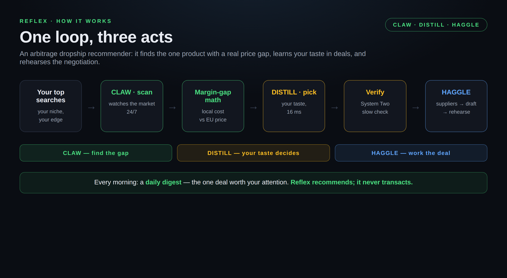
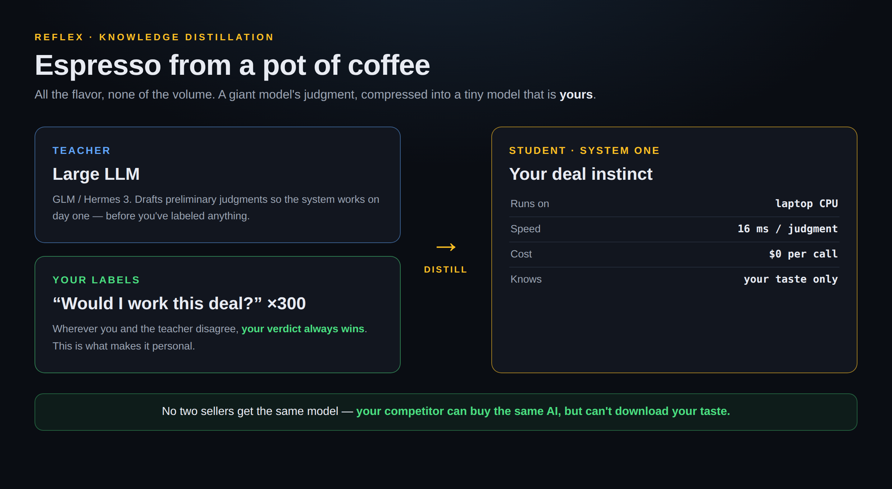
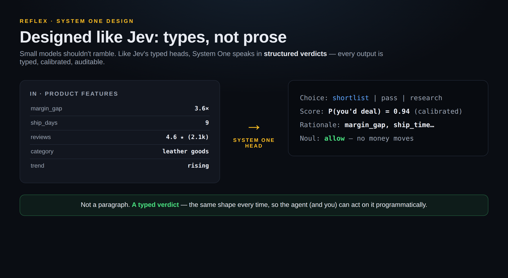
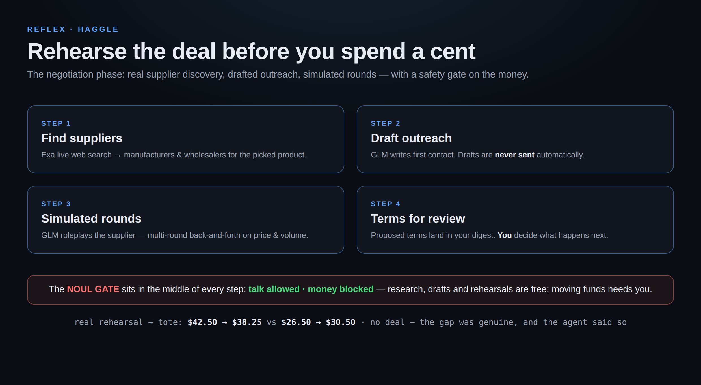

# ⚡ Reflex — Claw · Distill · Haggle

### *An arbitrage dropship recommender*

[](https://codespaces.new/syaikhipin/nemoclaw-demo)
&nbsp;·&nbsp; 🌐 **[Live site with animated demo →](https://syaikhipin.github.io/nemoclaw-demo/)**
&nbsp;·&nbsp; 📊 **[Pitch deck (PDF) →](docs/reflex-pitch-deck.pdf)**

**It watches what you search for, hunts the price gap between local sourcing and EU prices, and negotiates the deal.**

> *The same leather tote costs $12 to source locally and sells for €45 in the EU. That gap is a business — if you can find it before everyone else does.*

Built for the **NVIDIA Claw Agent Challenge** (Barcelona).

---

## The loop in one picture



Three acts, one loop:

- **🟢 CLAW — find the gap.** The agent starts from *your top searches* (your niche, your edge) and watches the market around the clock, computing the margin gap between local sourcing cost and EU retail price.
- **🟡 DISTILL — your taste decides.** Your deal criteria — margin floor, risk appetite, trusted categories — distilled into a tiny System One model that picks *the one* in 16 milliseconds, for free.
- **🔵 HAGGLE — work the deal.** Supplier discovery on the live web, drafted first outreach (never sent automatically), and simulated negotiation rounds so you walk in knowing your numbers.

Every morning: a **daily digest** — the one deal worth your attention. *Reflex recommends; it never transacts.*

---

## The novelty: knowledge distillation, made personal



Think of it like making an **espresso from a pot of coffee**: you keep all the flavor, lose the volume.

1. **A big AI teaches** (the "teacher" — your OpenAI-compatible LLM). It drafts preliminary judgments so the system works on day one.
2. **You teach.** You answer one question — *"would I work this deal?"* — a few hundred times.
3. **Your labels always win.** Wherever you and the teacher disagree, your verdict overrides. The final model is a **compressed copy of your judgment**, not a smaller copy of the teacher.
4. **The result is tiny.** It runs on a laptop CPU and judges a candidate in ~16ms — about as fast as you blinking.

**Why nobody else has this:** price trackers watch *everyone's* market; review scores aggregate *strangers'* opinions. Reflex learns from **one person's deal history: yours**. Your competitor can buy the same AI subscription — they cannot download your taste. Our literature review found no published personal, on-device decision model trained on a single user's decision history.

---

## System One, designed like Jev: types, not prose



Small models shouldn't ramble. Like [Jev](https://github.com/TianyuCodings)'s typed decision heads, Reflex's System One speaks in **structured verdicts** — the same shape every time, so the agent (and you) can act on it programmatically:

- **Choice:** `shortlist` · `pass` · `research`
- **Score:** a calibrated probability — "P(you'd work this deal) = 0.94"
- **Rationale:** which signals mattered most (margin gap, shipping time, …)
- **Noul:** the safety gate's verdict on the action

Two speeds of thinking (Kahneman's System 1 / System 2), built in:

| | 🟢 System One | 🔵 System Two |
|---|---|---|
| **What** | Your distilled deal instinct | A large AI analyst (your OpenAI-compatible LLM) |
| **Speed** | ~16 milliseconds | ~10–60 seconds |
| **Cost** | Free, runs on your laptop | Paid API call |
| **Handles** | Screening thousands of candidates | Verifying the one opportunity |

---

## Haggle: rehearse before you spend a cent



The negotiation phase, with a safety gate on the money:

1. **Find suppliers** — Exa live web search for manufacturers & wholesalers.
2. **Draft outreach** — the LLM writes first contact. Drafts are never sent automatically.
3. **Simulated rounds** — the LLM roleplays the supplier; multi-round back-and-forth on price and volume.
4. **Terms for review** — proposed terms land in your digest. You decide.

This session was real back-and-forth: supplier opened at $42.50/unit defending quality, your side anchored at $26.50 citing competing quotes, and they traded volume-for-price down to $38.25 vs $30.50. **No deal** — the gap was genuine, and the agent said so instead of inventing agreement.

---

## Watch it work

Real run, real dashboard — triage cycle on **v2 ID→EU pairs**, then a simulated negotiation (offline demo recording):


**The hunt.** One click scans the v2 pairs — each card shows the arbitrage: ID sourcing cost → EU price · margin multiple.


**Working the deal.** Live supplier search finds the brand's storefront; the agent drafts first outreach.


**The negotiation table.** The full simulated transcript.


**Talk to the claw.** The deep agent (scout → judge → analyst subagents) takes plain-English instructions: *"scan 4 fresh products, judge them, find suppliers for your top pick and draft outreach."* It did — then noted, unprompted, that no money moved so no safety approval was needed.

---

## Configuration — one `.env` does everything

Copy `.env.example` to `.env`. Every LLM provider is **OpenAI-compatible** — just `BASE_URL` + `API_KEY` + `MODEL`. Point them at any compatible endpoint (custom proxy, local server, another vendor) with zero code changes.

```bash
# --- LLM providers (OpenAI-compatible: base URL + key + model) ---
OPENAI_API_KEY=         # primary: your custom OpenAI-compatible endpoint
OPENAI_BASE_URL=https://api.openai.com/v1
OPENAI_MODEL=gpt-4o-mini

NVIDIA_API_KEY=         # fallback: NVIDIA NIM (free at https://build.nvidia.com)
NIM_MODEL=nousresearch/hermes-3-llama-3.1-70b
NIM_BASE_URL=https://integrate.api.nvidia.com/v1

# --- Supplier search (Haggle phase) ---
EXA_API_KEY=            # live web search (free at https://exa.ai)
SEARXNG_URL=            # optional local SearXNG fallback

# --- Behaviour ---
REFLEX_OFFLINE=0        # =1: deterministic offline stand-ins, no keys needed
REFLEX_HOME=~/.reflex   # SQLite memory, trained head, digests live here
REFLEX_SHORTLIST_AT=0.65
REFLEX_PASS_BELOW=0.35
REFLEX_SCAN_LIMIT=40
```

Provider priority is automatic: **OpenAI-compatible endpoint → NVIDIA NIM → offline**. No keys at all? Set `REFLEX_OFFLINE=1` and the whole demo runs on scripted stand-ins.

---

## Try it yourself

**One click, no setup:** [](https://codespaces.new/syaikhipin/nemoclaw-demo) — the dashboard starts automatically in offline demo mode; add `OPENAI_API_KEY` / `EXA_API_KEY` as Codespaces secrets and rebuild for the live version.

**Or locally:**

```bash
git clone https://github.com/syaikhipin/nemoclaw-demo.git && cd nemoclaw-demo
bash nemoclaw/scripts/onboard.sh     # creates venv, installs dependencies, copies .env.example → .env
bash nemoclaw/scripts/install.sh     # trains the demo head, runs the test suite

# web demo (the screenshots above)
OPENAI_API_KEY=your-key OPENAI_BASE_URL=https://api.openai.com/v1 EXA_API_KEY=your-key \
  .venv/bin/python -m reflex.web.app --port 8765
# open http://localhost:8765
```

Make it *yours* — this is where the magic happens:

```bash
.venv/bin/python -m scripts.label      # "would I work this deal?" — 300 for the pilot
.venv/bin/python -m scripts.retrain    # your labels always beat the teacher's
```

Your deal criteria live in `labeling-config.yaml` (EU market, margin-gap rubric) — correct any line and it becomes the next version.

---

## Under the hood (for the technical reader)

**Stack:** NemoClaw recipe layout · OpenClaw skill + cron · OpenAI-compatible LLM primary, Hermes via NVIDIA NIM next · LangChain Deep Agents harness (`create_deep_agent`, scout/judge/analyst subagents, 6+ tools) · Exa for supplier search · SQLite memory.

**Verified numbers** (held-out set, n=100): accuracy **0.91**, calibration error **0.079**, **97%** of products decided with zero LLM calls, p99 latency **42ms**. Test suite: **7/7 green.**

**Repo layout:**

| Path | What |
|---|---|
| `reflex/system_one/` | The distilled head — `DecisionHead` protocol + calibrated reference model + teacher-distillation pipeline |
| `reflex/system_two/` | Slow analyst (OpenAI-compatible → Hermes/NIM → offline fallback) |
| `reflex/negotiation/` | Exa supplier search, LLM outreach drafts, simulated multi-round negotiation |
| `reflex/deepagent/` | Deep-agents harness: model selection, tools, subagent prompts |
| `reflex/serve/` | The long-running claw loop (scan → judge → escalate → digest) |
| `reflex/noul.py` | Safety gate: talk allowed, money movement blocked |
| `reflex/memory.py` | Durable SQLite memory: products, judgments, labels, negotiations, runs |
| `reflex/web/` | The browser demo dashboard |
| `docs/` | GitHub Pages site (`index.html`) + architecture diagrams (`images/`) |
| `.devcontainer/` | 1-click GitHub Codespaces setup |
| `skills/reflex-triage/` | OpenClaw/Hermes skill definition |
| `nemoclaw/scripts/` | `onboard` / `install` / `start` (OpenClaw cron for 24/7) |
| `scripts/` | `bootstrap`, `label`, `retrain`, `run`, `fetch_amazon_data` |
| `eval/` | Held-out evaluation: accuracy, calibration, abstention, latency |

**Product data (v2):** `data/v2-arbitrage-pairs.jsonl` — 26 illustrative ID→EU deal pairs (ID sourcing cost vs EU retail, e.g. rattan tote ID $6.80 → EU $36.50). They are **plausible stand-ins**, not live marketplace listings: enough to train the head's margin-gap instinct and demo the full loop. Real marketplace adapters (ID marketplaces → EU retail feeds) plug in behind the same `ProductSource` interface. The Amazon fashion dataset is still available via `REFLEX_SOURCE=amazon` (40k-slice fetchable with `scripts/fetch_amazon_data.py`); `REFLEX_SOURCE=mock` gives the synthetic catalog.

---

## Honest limits

- The demo head trains on a synthetic persona's labels; it becomes *personal* only after you label (~300 pilot, 1–3k for pro).
- Ingesting your actual search history to seed the hunting ground is the design target; the current demo personalizes through your labels.
- Sourcing costs in the demo are estimates, not supplier quotes — margin math is indicative until a real quote lands.
- Negotiations are simulated rehearsals; Noul blocks real transactions until you approve.
- The reference head is CPU-friendly by design (trains in seconds anywhere); the Qwen3-0.6B typed-head path (CLM primary, NanoJev baseline) is specified in `docs/clm-head.md` and swaps in via the `DecisionHead` protocol.

---

*Reflex recommends; it never transacts.* · License: Apache-2.0
