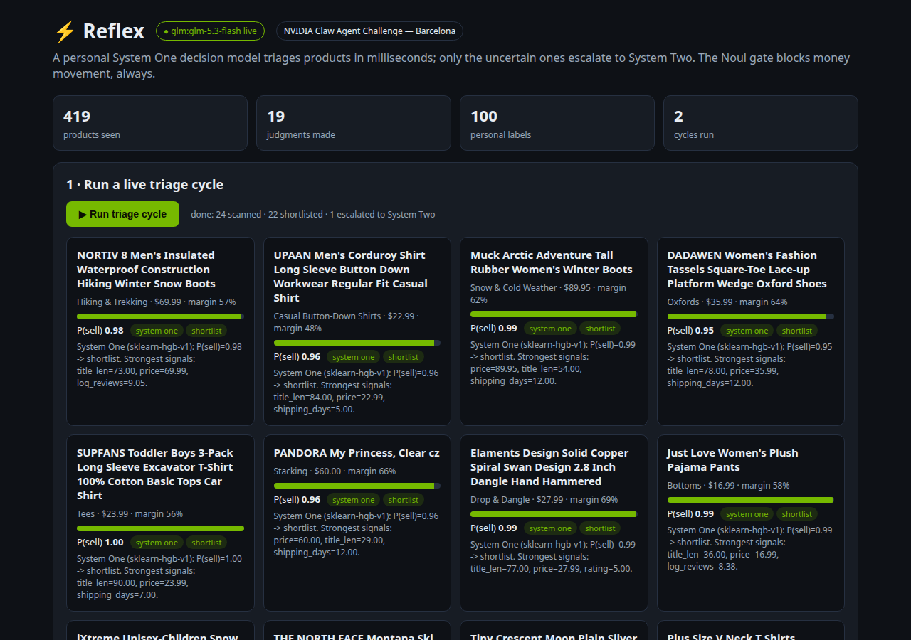
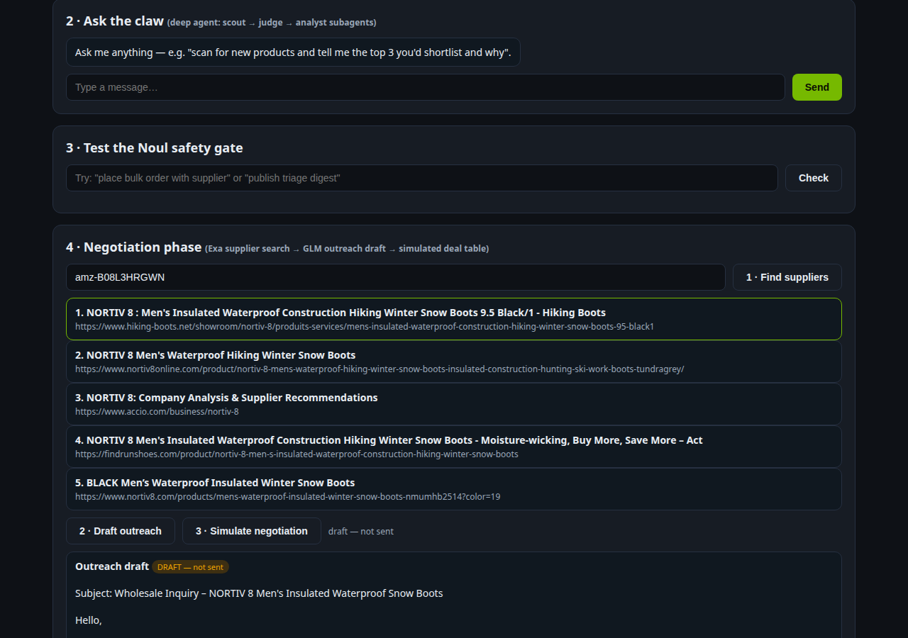
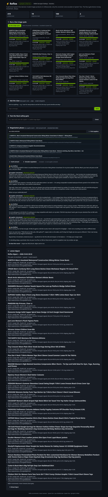

# ⚡ Reflex — your taste, distilled into an AI buyer

**A long-running claw agent that triages products the way *you* would — because it learned from your decisions.**

> *An independent seller faces 2,000 new products a week and can seriously evaluate maybe 20. Reflex learns which 20 you'd pick, watches the feeds around the clock, and hands you a shortlist every morning — then helps you negotiate with suppliers.*

Built for the **NVIDIA Claw Agent Challenge** (Barcelona).

---

## The problem, in plain words

Selling online is a curation game. Thousands of products launch daily; winners are found by sifting. Big sellers hire buyers to do the sifting. Independent sellers do it at midnight, alone, scrolling until their eyes blur.

Generic AI doesn't fix this: it doesn't know **your** taste — your margins, your customers, your gut feeling about what sells. Ask ten sellers "would you sell this?" and you'll get ten different answers. Taste is personal. So we stopped trying to build a smarter generic judge, and built something else:

**A junior buyer who shadows you, learns your taste from your own past decisions, and then pre-screens everything — in milliseconds, for free.**

---

## The novelty: a distilled System One model

This is the heart of the entry, and it's easiest to understand through the human brain.

### Two speeds of thinking

Psychologist Daniel Kahneman showed humans think in two systems: **System 1** — fast, instinctive, the gut feeling of an expert who has "seen this a thousand times" — and **System 2** — slow, deliberate, the careful analysis you do for hard calls.

Reflex works the same way:

| | System One 🟢 | System Two 🔵 |
|---|---|---|
| **What** | Your distilled taste | A large AI analyst (GLM / Hermes) |
| **Speed** | ~16 milliseconds | ~10–60 seconds |
| **Cost** | Free, runs on your laptop | Paid API call |
| **Handles** | ~97% of products | The ~3% uncertain ones |

The fast gut screens everything. Only the genuinely hard calls get escalated to the expensive brain. That's how you triage thousands of products without a thousand-dollar AI bill.

### "Distilled" — what does that actually mean?

Think of it like making an espresso from a pot of coffee: you keep all the flavor, lose the volume.

1. **You teach.** You answer one simple question — *"would I sell this?"* — a few hundred times (pilot) up to a few thousand (pro). That's the entire training program.
2. **A big AI assists** (the "teacher"). Before you've labeled enough, a large model drafts preliminary judgments so the system works on day one.
3. **Your labels always win.** Wherever you and the teacher disagree, your verdict overrides. This is the crucial part: **the final model is a compressed copy of your judgment, not a smaller copy of the teacher.**
4. **The result is tiny.** The distilled model is small enough to run on a laptop CPU, judging a product in ~16ms — about as fast as you blinking.

### Why nobody else has this

Product recommenders learn from *everyone's* clicks. Review scores aggregate *strangers'* opinions. Reflex learns from **one person's decisions: yours**. Your competitor can buy the same AI subscription you have — they cannot download your taste. In our literature review we found no published personal, on-device decision model trained on a single user's decision history. That's the gap this entry fills.

### Decisions you can audit

Every judgment comes back **typed**, not as a rambling paragraph:

- **Choice:** `shortlist` · `pass` · `research` (needs a closer look)
- **Score:** a calibrated probability — "P(you'd sell this) = 0.94"
- **Rationale:** which signals mattered most (margin, shipping speed, reviews…)

And the **Noul safety gate** sits in front of everything: the agent can research, draft, and negotiate — but it can never move money or commit funds without you. *Reflex recommends; it never transacts.*

---

## Watch it work

Real run, real Amazon products (fashion dataset), live in the browser demo:

**1 · One click runs a triage cycle.** 24 products scanned, 22 shortlisted, 1 escalated to System Two for a closer look.



**2 · Pick a winner and enter the negotiation phase.** Supplier discovery searches the live web for manufacturers — here it found the brand's own storefront.



**3 · The deal table.** The AI roleplays the supplier for multi-round negotiation. This session was real back-and-forth: supplier opened at $42.50/unit defending quality, your side anchored at $26.50 citing competing quotes, and they traded volume-for-price down to $38.25 vs $30.50. No deal — the gap was genuine, and the agent said so instead of inventing agreement.



**4 · Talk to the claw.** The deep agent (scout → judge → analyst subagents) takes plain-English instructions: *"scan 4 fresh products, judge them, find suppliers for your top pick and draft outreach."* It did — then noted, unprompted, that no money moved so no safety approval was needed.

---

## Try it yourself

```bash
git clone https://github.com/syaikhipin/nemoclaw-demo.git && cd nemoclaw-demo
bash nemoclaw/scripts/onboard.sh     # creates venv, installs dependencies
bash nemoclaw/scripts/install.sh     # trains the demo head, runs the test suite

# web demo (the screenshots above)
GLM_API_KEY=your-key EXA_API_KEY=your-key \
  .venv/bin/python -m reflex.web.app --port 8765
# open http://localhost:8765
```

Keys are free: GLM at [z.ai](https://z.ai), Exa at [exa.ai](https://exa.ai). Without keys, everything still runs in offline demo mode (`REFLEX_OFFLINE=1`).

Make it *yours* — this is where the magic happens:

```bash
.venv/bin/python -m scripts.label      # "would I sell this?" — 300 for the pilot
.venv/bin/python -m scripts.retrain    # your labels always beat the teacher's
```

---

## Under the hood (for the technical reader)

**Stack:** NemoClaw recipe layout · OpenClaw skill + cron · GLM (z.ai) primary, Hermes via NVIDIA NIM next · LangChain Deep Agents harness (`create_deep_agent`, scout/judge/analyst subagents, 6+ tools) · Exa for supplier search · SQLite memory.

**Verified numbers** (held-out set, n=100): accuracy **0.91**, calibration error **0.079**, **97%** of products decided with zero LLM calls, p99 latency **42ms**. Test suite: **7/7 green.**

**Repo layout:**

| Path | What |
|---|---|
| `reflex/system_one/` | The distilled head — `DecisionHead` protocol + calibrated reference model + teacher-distillation pipeline |
| `reflex/system_two/` | Slow analyst (GLM → Hermes/NIM → offline fallback) |
| `reflex/negotiation/` | Exa supplier search, GLM outreach drafts, simulated multi-round negotiation |
| `reflex/deepagent/` | Deep-agents harness: model selection, tools, subagent prompts |
| `reflex/serve/` | The long-running claw loop (scan → judge → escalate → digest) |
| `reflex/noul.py` | Safety gate: talk allowed, money movement blocked |
| `reflex/memory.py` | Durable SQLite memory: products, judgments, labels, negotiations, runs |
| `reflex/web/` | The browser demo dashboard |
| `skills/reflex-triage/` | OpenClaw/Hermes skill definition |
| `nemoclaw/scripts/` | `onboard` / `install` / `start` (OpenClaw cron for 24/7) |
| `scripts/` | `bootstrap`, `label`, `retrain`, `run`, `fetch_amazon_data` |
| `eval/` | Held-out evaluation: accuracy, calibration, abstention, latency |
| `docs/` | Labeling protocol · Qwen3-0.6B (CLM/NanoJev) upgrade path |

**Product data:** real Amazon fashion products (the dataset behind [qdrant-labs/demo-ecommerce-search](https://github.com/qdrant-labs/demo-ecommerce-search), 40k-slice via `scripts/fetch_amazon_data.py`). Titles, prices, ratings, images are real; sourcing cost and shipping days are deterministic documented estimates.

---

## Honest limits

- The demo head trains on a synthetic persona's labels; it becomes *personal* only after you label (~300 pilot, 1–3k for pro).
- Negotiation drafts and simulations contact nobody and move no money — Noul blocks real transactions until you approve.
- The reference head is CPU-friendly by design (trains in seconds anywhere); the Qwen3-0.6B typed-head path (CLM primary, NanoJev baseline) is specified in `docs/clm-head.md` and swaps in via the `DecisionHead` protocol.

---

*Reflex recommends; it never transacts.* · License: Apache-2.0
